# The factory: from a ticket to main

How a change gets from a ticket into `main` in this repository, and what is verified on the
way. The rules behind the gates are in `AGENTS.md` ("Working with tickets", "Quality gate",
"Process rules"); this file is the map. Drawn on Day 10 of the Qodo Hackathon 2026 and checked
against one real ticket, T-028 (`journal/day-10.md`).

## Diagram

Thick border: a step T-028 actually went through on Nov 13. Dashed: planned, not built.
Hexagon: a decision only the human makes. Plain: exists, not used by T-028.

```mermaid
flowchart TD
  T["Ticket: tickets/T-NNN-*.md<br/>and a GitHub issue titled T-NNN: ..."]:::taken
  T --> G1{"Gate 1, before work<br/>Is every claim the ticket makes<br/>about the code true?<br/>Codebase Wisdom, or run the command"}:::taken
  G1 -- "a claim is wrong" --> REV["Ticket revised:<br/>criteria changed, Investigation section written"]:::taken
  REV --> HT{{"Human reads the revised ticket<br/>and decides the open choices"}}:::taken
  HT --> LANE{{"Human picks the lane"}}:::taken
  G1 -- "all hold" --> LANE

  LANE -- "session" --> IMP["Agent implements test-first<br/>nothing committed"]:::taken
  IMP --> G2{"Gate 2<br/>npm run check"}:::taken
  G2 -- "red" --> IMP
  G2 -- "green" --> G3{"Gate 3, uncommitted code<br/>Qodo local review: staged, unstaged, new files<br/>one deep review, last review covers the final tree"}:::taken
  G3 -- "valid High or Medium<br/>fix round 1 to 3" --> IMP
  G3 -- "agent disputes a High or Medium" --> HD{{"Human decides:<br/>fix, amend the rule, or dismiss"}}
  HD --> IMP
  G3 -- "3 fix rounds, still open" --> STOP["Stop: gate NOT MET<br/>report with the open findings"]
  STOP --> HS{{"Human decides what the stop means"}}
  HS -- "redesign or cut scope" --> IMP
  HS -- "exception: the gate stays NOT MET,<br/>that is recorded, and the open<br/>findings go on to the pull request" --> G4
  G3 -- "no High or Medium open<br/>Lows listed" --> G4{{"Gate 4, the human<br/>reads the gate report,<br/>commits and opens the pull request"}}:::taken

  LANE -- "label" --> LBL{{"Human adds ready-for-agent"}}
  LBL --> GL{"Guard<br/>issue has a non-empty Investigation?<br/>scripts/ticket-ready.ts"}
  GL -- "no: label removed,<br/>comment says why" --> T
  GL -- "yes" --> BOT["Bot implements on agent/issue-N-*<br/>npm run check, 3 attempts, then stop and report"]
  BOT --> PEND["Bot comments: Implemented, gate pending<br/>no Qodo review has run yet"]
  BOT -. "planned" .-> BREV["PLANNED, T-029<br/>Qodo review of the branch in a separate job<br/>that never runs ticket-written code"]:::planned
  BREV -. "planned" .-> PEND
  PEND --> HO{{"Gate 4, the human<br/>opens the pull request"}}

  G4 --> G5A{"Gate 5a, enforced by GitHub<br/>branch protection requires, on the head:<br/>check on Linux, check on Windows, ticket-link"}:::taken
  HO --> G5A
  G5A -- "a check is red" --> FIX["Fix test-first, new commit on the PR branch<br/>session: the agent commits on its own<br/>label lane: the human comments @claude,<br/>the bot pushes, agent/* branches only"]:::taken
  FIX -- "new head: checks and review run again" --> G5A
  G5A -- "green" --> G5B{"Gate 5b, by procedure, not enforced<br/>the agent reads Qodo's review with Review Resolver:<br/>completed for the head, no High or Medium open"}:::taken
  G5B -- "valid High or Medium" --> FIX
  G5B -- "a finding needs a decision:<br/>dispute, dismissal, any Low" --> HP{{"Human decides per finding"}}
  HP -- "fix it" --> FIX
  HP -- "no code change: dismissed with a reason,<br/>or a Low left as it is" --> G5B
  G5B -- "gate report says MET" --> HM{{"Human merges<br/>GitHub refuses a head that fails 5a<br/>5b rests on the gate report"}}:::taken
  HM --> MAIN["main"]:::taken
  MAIN --> AFTER["After the merge<br/>GitHub closes the issue<br/>Qodo updates its copy of the rules<br/>observed on Nov 13, verified by no gate"]:::taken

  classDef taken stroke-width:3px
  classDef planned stroke-dasharray: 5 5
```

## The gates

| Gate | What must pass | Evidence the agent uses | When it fails | Who decides |
|---|---|---|---|---|
| 1. Before work | Every claim the ticket makes about the existing code is checked. The result is the ticket's `**Investigation.**` section. | Codebase Wisdom results saved as raw JSON under `evidence/`, or the output of the command the ticket describes. An empty search result counts only with a control query that had to match. | The ticket is revised before any code is written. | The human reads the revised ticket and settles the choices it lists. |
| Guard (label lane) | The issue body has a non-empty Investigation section. | `scripts/ticket-ready.ts` on the current issue body. | The label is removed and a comment says why. A guard that fails to run leaves the label on and blames nothing on the ticket. | The human adds the label again after fixing the ticket. |
| 2. Checks | `npm run check`: typecheck and tests. Code fixes start with a failing test. | Test output; the red run is kept under `evidence/`. | Back to implementation. The bot stops after three attempts and reports. | The agent. |
| 3. Uncommitted code | The quality gate in `AGENTS.md`: every valid High and Medium finding fixed, at least one deep review, the last review covers the final tree including new files. | `qodo review` JSON: findings, `finding_state`, coverage; the gate report in the journal. | Fix test-first and review again, at most three rounds. Then stop with NOT MET. | The agent fixes. The human decides a disputed High or Medium and every Low. After a stop the human either sends the work back (redesign, smaller scope) or lets it go on as a recorded exception: the gate stays NOT MET and the open findings travel to the pull request. A stop never turns into a pass. |
| 4. Commit and pull request | The human has read the gate report. | The gate report: one row per finding, the checks, the last review, `Quality gate: MET` or `NOT MET`. | — | The human makes the first commit and opens the pull request. On the label lane the bot has committed already and the human only opens it. |
| 5a. Pull request head, enforced | `check (ubuntu-latest)`, `check (windows-latest)` and `ticket-link` are green on the head commit. | `gh pr checks`. | A fix on the PR branch moves the head and reruns everything. | GitHub: branch protection on `main` refuses the merge. Nobody has to remember this one. |
| 5b. Pull request head, by procedure | Qodo's latest completed review is for the head commit (a skipped review counts only after Markdown-and-evidence-only commits) and no High or Medium finding is open. | The review session read with the Review Resolver skill: status, `commit_sha`, each finding's `attribution_status`. | Valid High or Medium: a fix, as in 5a. A dispute, a dismissal or a Low goes to the human, who either asks for a fix or settles it without a code change (a dismissal with a reason, a Low left as it is); the gate is then evaluated again. | The agent reports; the human decides. **Nothing in GitHub enforces 5b.** A pull request with an open High can be merged if the human ignores the gate report. |
| Merge | 5a green and the gate report says MET. | The gate report. | — | The human. |

Who makes the fix commit on a pull request depends on the lane. In a session the agent commits
and pushes on its own once the human has opened the pull request (`AGENTS.md`, process rules).
On the label lane nothing happens until the human comments `@claude` on the pull request; the
bot then pushes, and only to `agent/*` branches (`.github/workflows/agent-fix.yml`).

Gate numbers follow the order of the path: 4 is the human's commit, which is why the automatic
gates jump from 3 to 5.

What `ticket-link` checks: a pull request that names a ticket in its title, or closes a ticket's
issue, must close that ticket's own issue (GitHub is asked which issues the pull request will
close) and must carry the `BACKLOG.md` row `done (PR <number>)`.

Where the loop stops: three failed check attempts (bot), three fix rounds (any review loop), a
finding the agent disputes, a label it cannot map to a severity, a review that failed or could
not run. Each of these ends in a report and a question, not in a guess.

## Checked against T-028 (Nov 13)

Ticket: `tickets/T-028-source-hygiene.md`, issue #23, pull request #24. Session lane.

| Step | What happened | Evidence |
|---|---|---|
| Gate 1 | The backlog row was wrong twice. The rule was already broken on `main` (a raw byte order mark since Nov 5), and "all of `tests/`" would have caught fixtures that hold raw bytes on purpose. The ticket was rewritten before any code. One search returned an empty result that was false; a second query exposed it. | `evidence/day10/raw/`, the ticket's Investigation section |
| Human | Settled the ticket's open choice (visible non-ASCII stays allowed) and told the agent to go on. | the ticket, Decisions |
| Gate 2 | Red first: the new test failed on exactly the two lines the investigation had found. Then 222 tests green. | `evidence/day10/red-t028-*.txt` |
| Gate 3 | Two deep reviews of the uncommitted change. Review 1: no High or Medium, three Lows: the gate was met at once. The human chose to fix all three; review 2: nothing new, all resolved. One fix round of three. | `evidence/day10/t028-review-*.json` |
| Gate 4 | The human committed and opened the pull request. | `3b09408` |
| Gate 5a | `ticket-link` was red on the first commit, as designed (`BACKLOG.md row for T-028 says "planned", expected "done (PR 24)"`), and green after the agent set the row. Both `check` jobs green on every head. | the pull request's checks |
| Gate 5b | Qodo's PR review found one Medium the local reviews had not (a file name with a control character could split the report); the agent fixed it test-first and pushed; the next review marked it implemented. No finding open at the head. | `evidence/day10/pr24-review-*.json` |
| Merge | The human's. | pull request #24 |
| After | GitHub closed issue #23 by itself. Qodo's rule list showed rule 7 a minute after the merge; nobody had checked for it. | `journal/day-10.md` |

What worked: every gate on the session lane ran, and each one caught something the gate
before it had not. What the human did: decided the ticket's open choice, decided the Lows,
made the first commit, opened the pull request, merged. What was not exercised by this ticket:
a disputed finding, the three-round stop (the gap fixes hit it the same morning,
`journal/day-10.md`), and the whole label lane.

Missing verification found on the way: nothing in the factory noticed that the agent's own
file writes kept inserting raw invisible characters into Markdown files (ticket, journal). Rule
7 covers `.ts` files only; the Markdown was scanned by hand.

## Known gaps

- **Label lane, before the commit: no Qodo review.** The bot has no Qodo credentials on
  purpose: every test it runs for a ticket could read them. T-029 (Day 16) plans a review of the
  bot's branch in a separate job. Until then the lane ends with "Implemented, gate pending" and
  the first Qodo review is the one on the pull request.
- **Label lane, gate 1 is a presence check.** The guard sees that an Investigation section
  exists, not that it is right.
- **The checks can be edited by the pull request they check.** On a `pull_request` event the
  workflow and the scripts come from the pull request. They catch slips, not intent; the human
  reviews changes to them.
- **After the merge, nothing checks that Qodo's copy of the rules followed `AGENTS.md`.** Qodo
  imported the changed rules by itself within a minute of both merges on Nov 13 (it had not on
  Day 2), but that was noticed by reading the rule list, not by a gate. Until the import runs,
  the reviewer judges a pull request by the old text.
- **Admins can bypass branch protection.** That is how the human pushes journal commits to
  `main`; it also means the protection does not bind the human.
