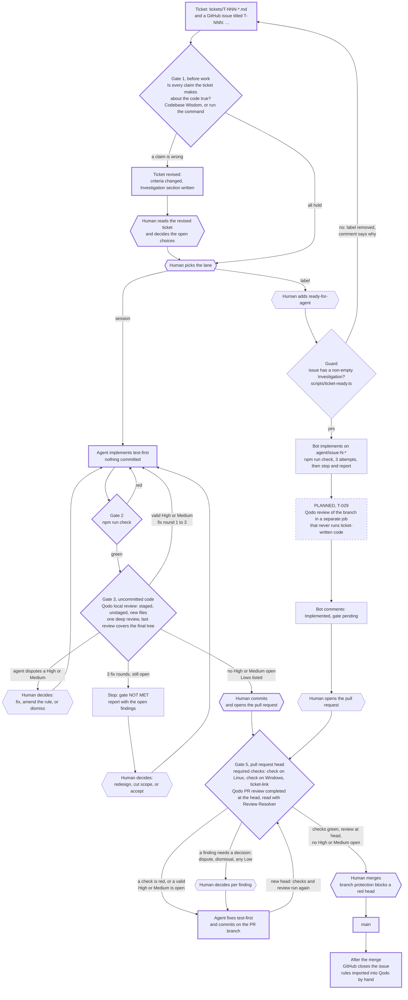

# The factory: from a ticket to main

How a change gets from a ticket into `main` in this repository, and what is verified on the
way. The rules behind the gates are in `AGENTS.md` ("Working with tickets", "Quality gate",
"Process rules"); this file is the map. Drawn on Day 10 of the Qodo Hackathon 2026 and checked
against one real ticket, T-028 (`journal/day-10.md`).

## Diagram

Thick border: a step T-028 actually went through on Nov 13. Dashed: planned, not built.
Hexagon: a decision only the human makes. Plain: exists, not used by T-028.

## The gates

| Gate | What must pass | Evidence the agent uses | When it fails | Who decides |
|---|---|---|---|---|
| 1. Before work | Every claim the ticket makes about the existing code is checked. The result is the ticket's `**Investigation.**` section. | Codebase Wisdom results saved as raw JSON under `evidence/`, or the output of the command the ticket describes. An empty search result counts only with a control query that had to match. | The ticket is revised before any code is written. | The human reads the revised ticket and settles the choices it lists. |
| Guard (label lane) | The issue body has a non-empty Investigation section. | `scripts/ticket-ready.ts` on the current issue body. | The label is removed and a comment says why. A guard that fails to run leaves the label on and blames nothing on the ticket. | The human adds the label again after fixing the ticket. |
| 2. Checks | `npm run check`: typecheck and tests. Code fixes start with a failing test. | Test output; the red run is kept under `evidence/`. | Back to implementation. The bot stops after three attempts and reports. | The agent. |
| 3. Uncommitted code | The quality gate in `AGENTS.md`: every valid High and Medium finding fixed, at least one deep review, the last review covers the final tree including new files. | `qodo review` JSON: findings, `finding_state`, coverage; the gate report in the journal. | Fix test-first and review again, at most three rounds. Then stop with NOT MET. | The agent fixes. The human decides a disputed High or Medium, every Low, and what happens after a stop. |
| 5. Pull request head | Required checks green on the head: `check (ubuntu-latest)`, `check (windows-latest)`, `ticket-link`. Qodo's latest completed review is for the head commit (a skipped review counts only after Markdown-and-evidence-only commits). No High or Medium open. | `gh pr checks`; the review session read with the Review Resolver skill: status, `commit_sha`, each finding's `attribution_status`. | The agent fixes on the PR branch, which moves the head and reruns everything. | The agent fixes and pushes on its own. The human decides disputes, dismissals and Lows; only the human records a dismissal's reason. |
| Merge | Gate 5 met. | The gate report: `Quality gate: MET`. | — | The human. Branch protection on `main` refuses a head whose required checks are not green. |

What `ticket-link` checks: a pull request that names a ticket in its title, or closes a ticket's
issue, must close that ticket's own issue (GitHub is asked which issues the pull request will
close) and must carry the `BACKLOG.md` row `done (PR <number>)`.

Where the loop stops: three failed check attempts (bot), three fix rounds (any review loop), a
finding the agent disputes, a label it cannot map to a severity, a review that failed or could
not run. Each of these ends in a report and a question, not in a guess.

## Checked against T-028 (Nov 13)

Ticket: `tickets/T-028-source-hygiene.md`, issue #23, pull request #24. Session lane.

| Step | What happened | Evidence |
|---|---|---|
| Gate 1 | The backlog row was wrong twice. The rule was already broken on `main` (a raw byte order mark since Nov 5), and "all of `tests/`" would have caught fixtures that hold raw bytes on purpose. The ticket was rewritten before any code. One search returned an empty result that was false; a second query exposed it. | `evidence/day10/raw/`, the ticket's Investigation section |
| Human | Settled the ticket's open choice (visible non-ASCII stays allowed) and told the agent to go on. | the ticket, Decisions |
| Gate 2 | Red first: the new test failed on exactly the two lines the investigation had found. Then 222 tests green. | `evidence/day10/red-t028-*.txt` |
| Gate 3 | Two deep reviews of the uncommitted change. Review 1: no High or Medium, three Lows: the gate was met at once. The human chose to fix all three; review 2: nothing new, all resolved. One fix round of three. | `evidence/day10/t028-review-*.json` |
| Human | Committed and opened the pull request. | `3b09408` |
| Gate 5 | `ticket-link` was red on the first commit, as designed (`BACKLOG.md row for T-028 says "planned", expected "done (PR 24)"`), and green after the agent set the row. Both `check` jobs green on every head. Qodo's PR review found one Medium the local reviews had not (a file name with a control character could split the report); the agent fixed it test-first and pushed; the next review marked it implemented. No finding open at the head. | `evidence/day10/pr24-review-*.json` |
| Merge | The human's. | pull request #24 |

What worked: every gate on the session lane ran, and each one caught something the gate
before it had not. What the human did: decided the ticket's open choice, decided the Lows,
made the first commit, opened the pull request, merged. What was not exercised by this ticket:
a disputed finding, the three-round stop (the gap fixes hit it the same morning,
`journal/day-10.md`), and the whole label lane.

Missing verification found on the way: nothing in the factory noticed that the agent's own
file writes kept inserting raw invisible characters into Markdown files (ticket, journal). Rule
7 covers `.ts` files only; the Markdown was scanned by hand.

## Known gaps

- **Label lane, before the commit: no Qodo review.** The bot has no Qodo credentials on
  purpose: every test it runs for a ticket could read them. T-029 (Day 16) plans a review of the
  bot's branch in a separate job. Until then the lane ends with "Implemented, gate pending" and
  the first Qodo review is the one on the pull request.
- **Label lane, gate 1 is a presence check.** The guard sees that an Investigation section
  exists, not that it is right.
- **The checks can be edited by the pull request they check.** On a `pull_request` event the
  workflow and the scripts come from the pull request. They catch slips, not intent; the human
  reviews changes to them.
- **After the merge, one step is still manual and unverified:** importing changed rules from
  `AGENTS.md` into Qodo's Review Standards.
- **Admins can bypass branch protection.** That is how the human pushes journal commits to
  `main`; it also means the protection does not bind the human.
